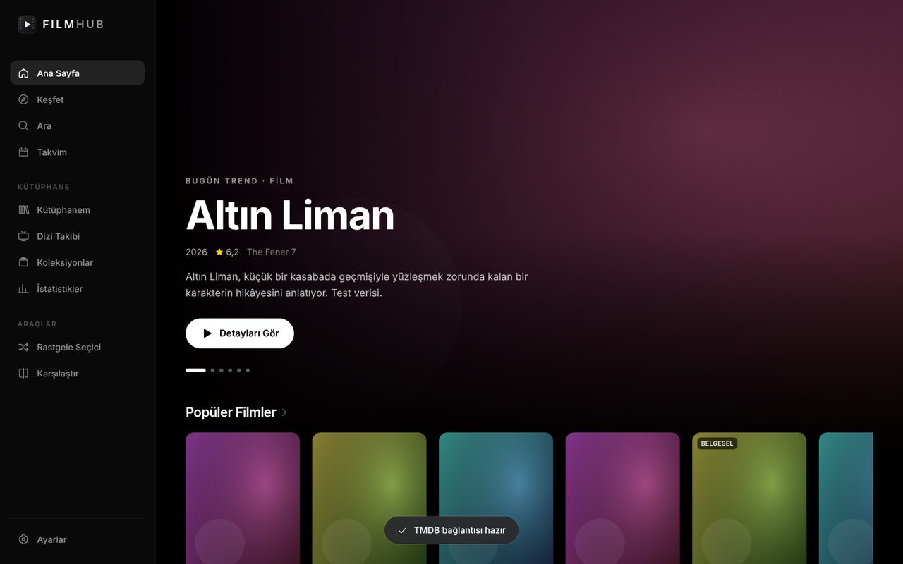
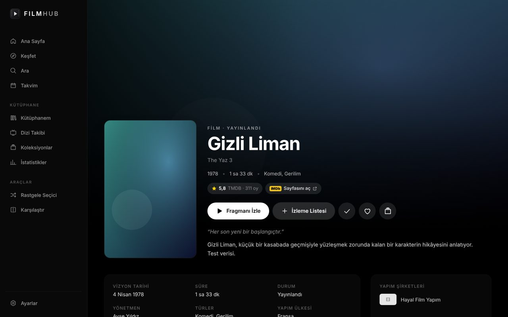
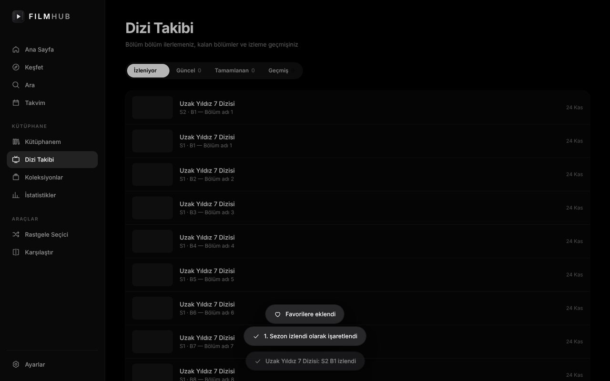
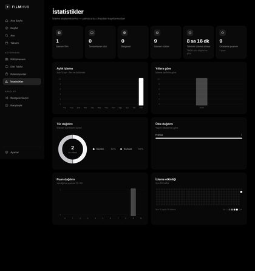
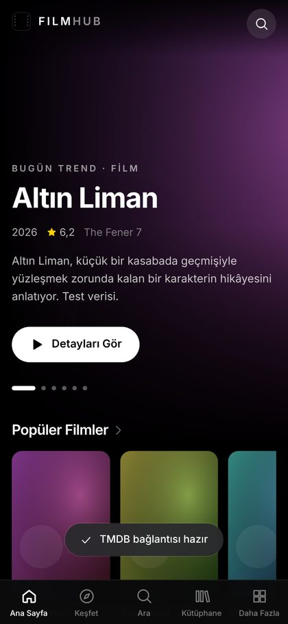
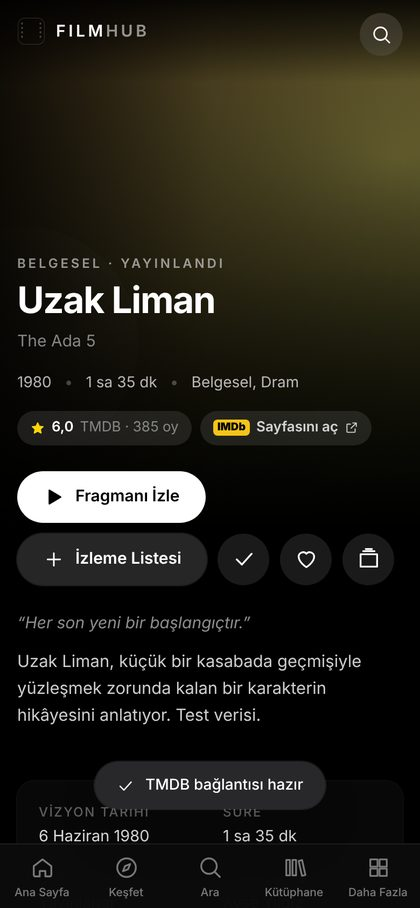
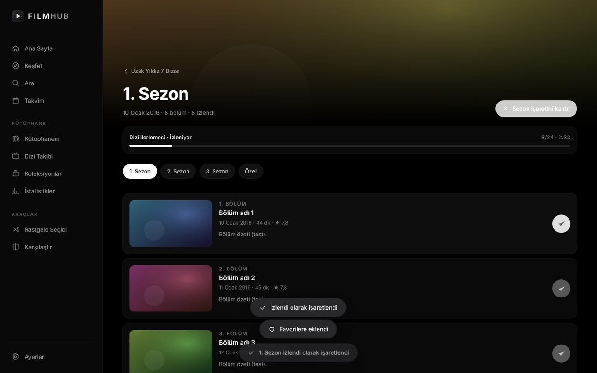
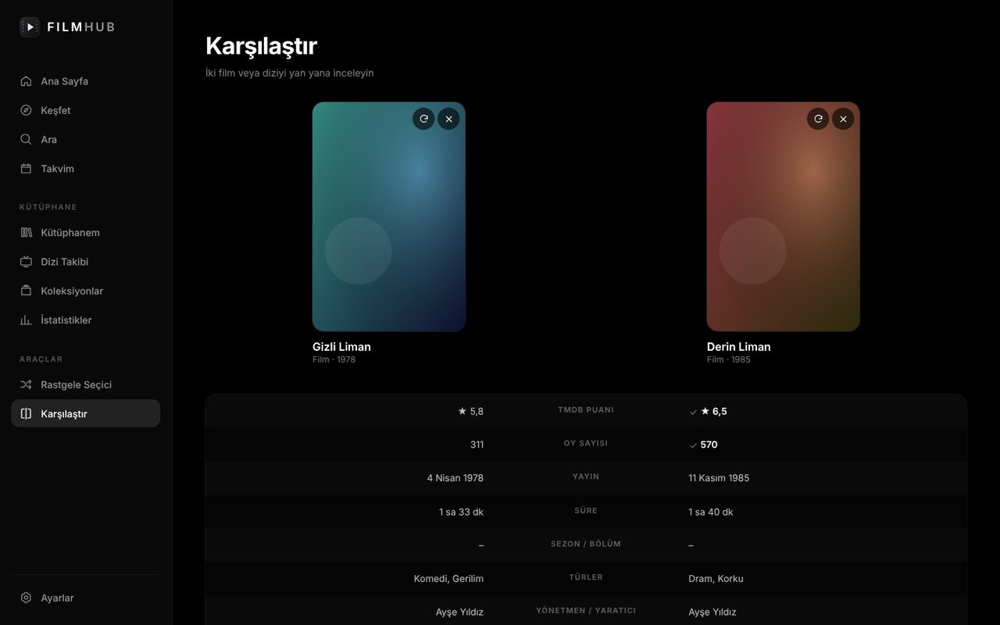

<div align="center">


# FILMHUB

**Film, dizi ve belgesel keşif & kişisel koleksiyon platformu**

Windows · Android · Web — tek kod tabanı, aynı premium deneyim




</div>

---

## ✨ Özellikler

| | |
|---|---|
| 🎬 **Keşif** | Öne çıkanlar vitrini, trend & popüler listeler, belgeseller, yakında vizyonda, günün filmi, küratörlü koleksiyonlar, tür kâşifi |
| 📄 **Detay sayfaları** | Türkçe + orijinal ad, özet, süre, türler, ülkeler, yapım şirketleri, TMDB puanı, IMDb bağlantısı, oyuncu & ekip, fragmanlar, galeri, benzer içerikler |
| 🔎 **Arama** | Film / dizi / belgesel / oyuncu / yönetmen; otomatik tamamlama, öneriler, geçmiş, tür-yıl-puan-ülke filtreleri, sıralama, sonsuz kaydırma |
| 📚 **Kütüphane** | İzlediklerim · İzleme Listem · Favorilerim; kişisel notlar, kütüphane içi arama, filtre ve sıralama, çift kayıt engeli |
| ⭐ **Puan & yorum** | 0–10 arası, 0,5 adımlı kişisel puan; yorum ekleme / düzenleme / silme (topluluk puanından ayrı) |
| 📺 **Dizi takibi** | Bölüm bölüm işaretleme, sezon & genel ilerleme, sıradaki bölüm, izleme geçmişi, *İzleniyor / Güncel / Tamamlandı* durumları |
| 📊 **İstatistikler** | Film / dizi / belgesel / bölüm sayıları, tahmini izleme süresi, ortalama puan, tür & ülke dağılımı, aylık / yıllık grafikler, ısı haritası |
| 🗂️ **Koleksiyonlar** | Kendi listelerinizi oluşturun, adlandırın, kapak seçin, sıralayın, filtreleyin |
| 🧰 **Araçlar** | Rastgele seçici, iki yapımı karşılaştırma, 90 günlük yayın takvimi |

> FILMHUB tam uzunlukta film veya bölüm **yayınlamaz**. Fragmanlar yalnızca YouTube’un resmi gömme oynatıcısıyla gösterilir.

## 📸 Ekran görüntüleri

| Detay | Dizi takibi | İstatistikler |
|---|---|---|
|  |  |  |

| Mobil ana sayfa | Mobil detay | Sezon | Karşılaştırma |
|---|---|---|---|
|  |  |  |  |

<sub>Ekran görüntüleri otomatik E2E testleri sırasında, hayali test verileriyle alınmıştır.</sub>

## 🚀 Hızlı başlangıç

```bash
git clone https://github.com/furkantr1923/filmhub.git
cd filmhub
npm install
npm run dev          # http://localhost:5173
```

İlk açılışta ücretsiz **TMDB API anahtarınızı** girin → [docs/API_SETUP.md](docs/API_SETUP.md)

## 📦 İndirme (hazır sürümler)

Her `main` gönderiminde GitHub Actions üç platformu otomatik derler ve **Releases** sayfasına ekler:

| Platform | Dosya |
|---|---|
| Windows kurulum | `FILMHUB-Setup.exe` |
| Windows kurulumsuz | `FILMHUB-Portable.exe` |
| Android | `FILMHUB.apk` |
| Web | `FILMHUB-Web.zip` |

## 🏗️ Teknoloji

**React 19 · TypeScript (strict) · Tailwind CSS v4 · esbuild · IndexedDB · Electron · Capacitor · Playwright**

```
src/
├── api/            TMDB istemcisi (önbellek, tekilleştirme, rate-limit, hata yönetimi)
├── db/             Depolama arayüzü + IndexedDB / bellek adaptörleri + migration'lar
├── repositories/   Kütüphane, puan, dizi, koleksiyon, arama geçmişi, tercihler
├── services/       İstatistik, dizi ilerlemesi, filtre/sıralama, olay yolu
├── components/     Tasarım sistemi (kart, şerit, modal, grafik, oynatıcı…)
├── pages/          17 ekran (kod bölme ile tembel yüklenir)
├── platform/       Web / Windows / Android farkları
└── router/         Hash tabanlı yönlendirici
electron/           Windows kabuğu        tests/unit/   56 birim testi
scripts/            Derleme araçları      tests/e2e/    40 adımlık tarayıcı testi
```

Ayrıntılar: [ARCHITECTURE.md](docs/ARCHITECTURE.md)

## 🧪 Testler

```bash
npm test              # 56 birim testi (veritabanı, dizi takibi, istatistik, API)
npm run build && npm run test:e2e   # 40 adımlık gerçek tarayıcı testi
```

Sonuçlar: [TEST_REPORT.md](docs/TEST_REPORT.md)

## 📚 Dokümantasyon

[Kurulum](docs/INSTALLATION.md) · [Mimari](docs/ARCHITECTURE.md) · [API kurulumu](docs/API_SETUP.md) · [Derleme rehberi](docs/BUILD_GUIDE.md) · [Test raporu](docs/TEST_REPORT.md)

## 🔐 Gizlilik

Hesap, kayıt, sunucu veya bulut senkronizasyonu yoktur. Tüm kişisel veriler **yalnızca cihazınızda** saklanır.
Yedekleme bilinçli olarak bulunmadığından uygulamayı kaldırmak kayıtların kalıcı olarak silinmesine yol açabilir.

## 🙏 Atıf


Bu ürün TMDB API’sini kullanır ancak TMDB tarafından onaylanmamış veya sertifikalandırılmamıştır.

---

<div align="center"><sub>Designed &amp; Developed by <b>Furkan</b> · MIT Lisansı</sub></div>
